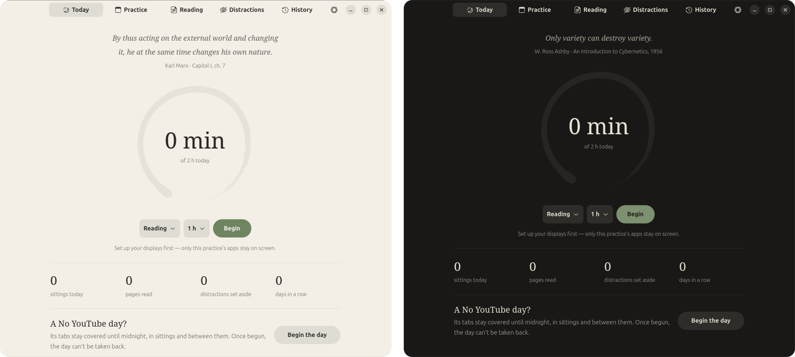
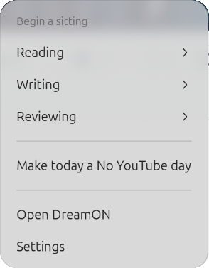
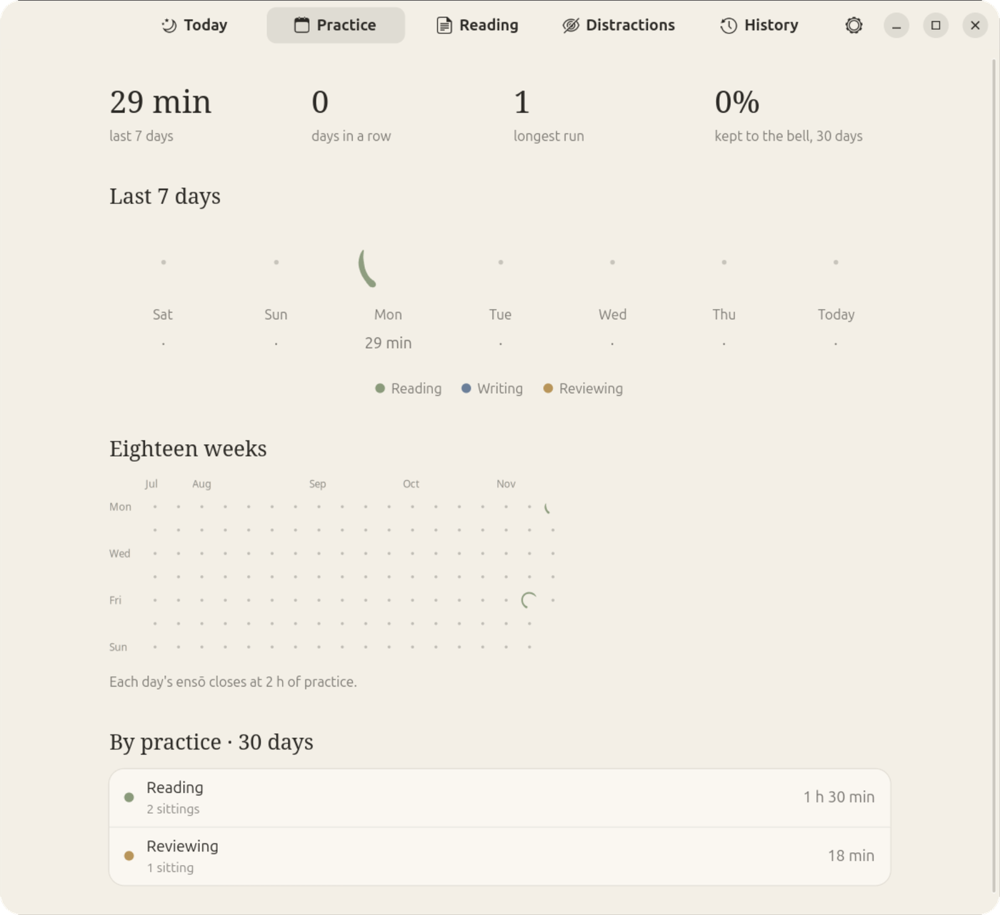
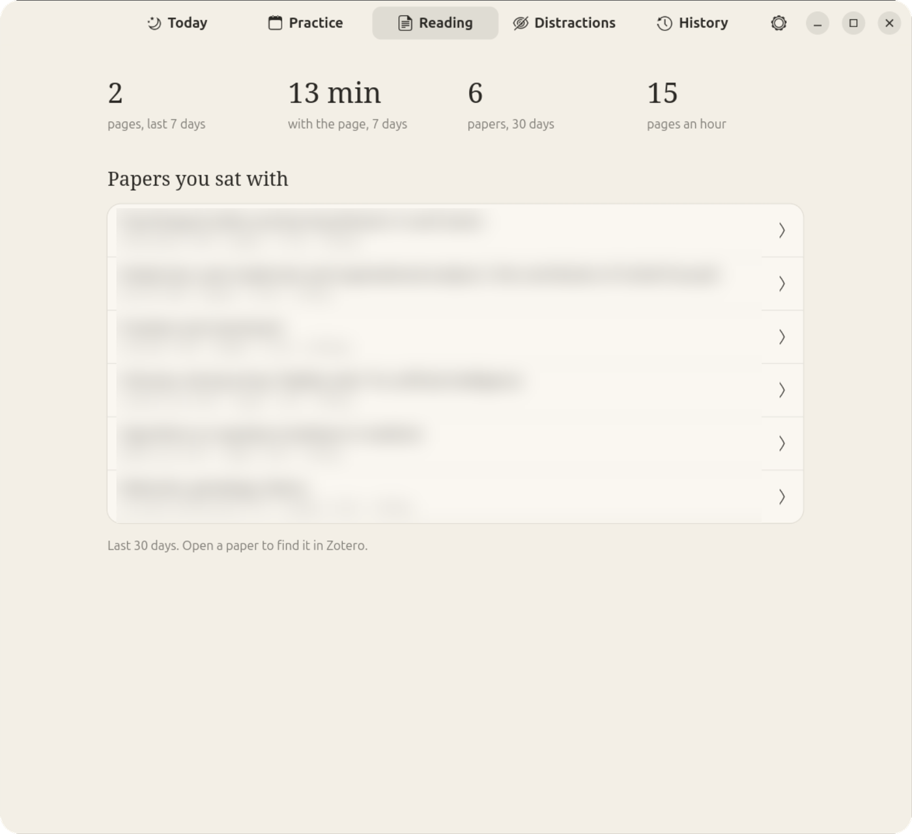
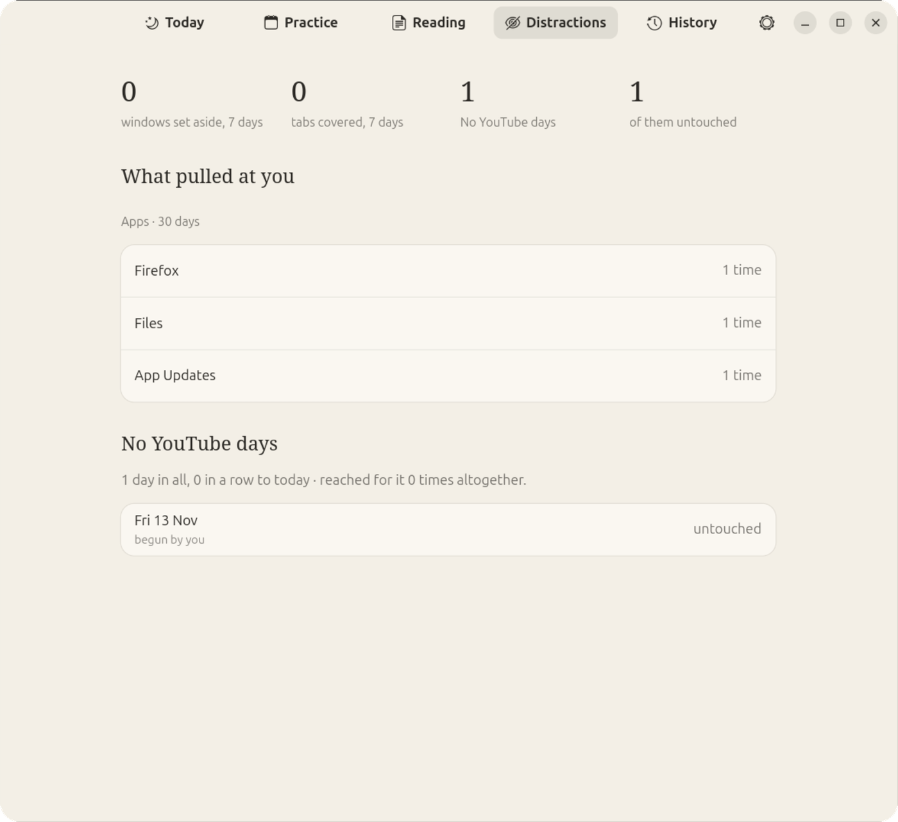
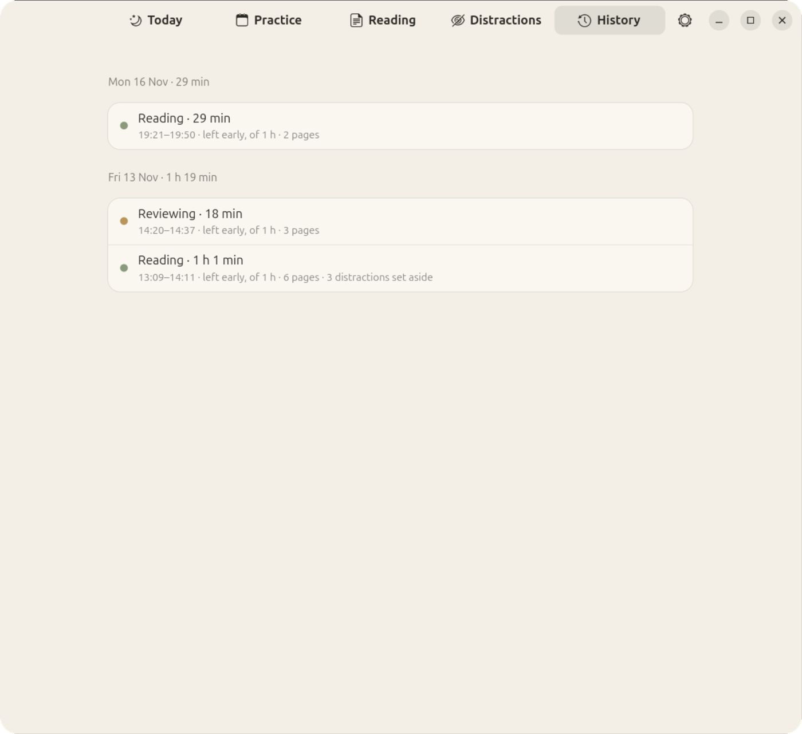
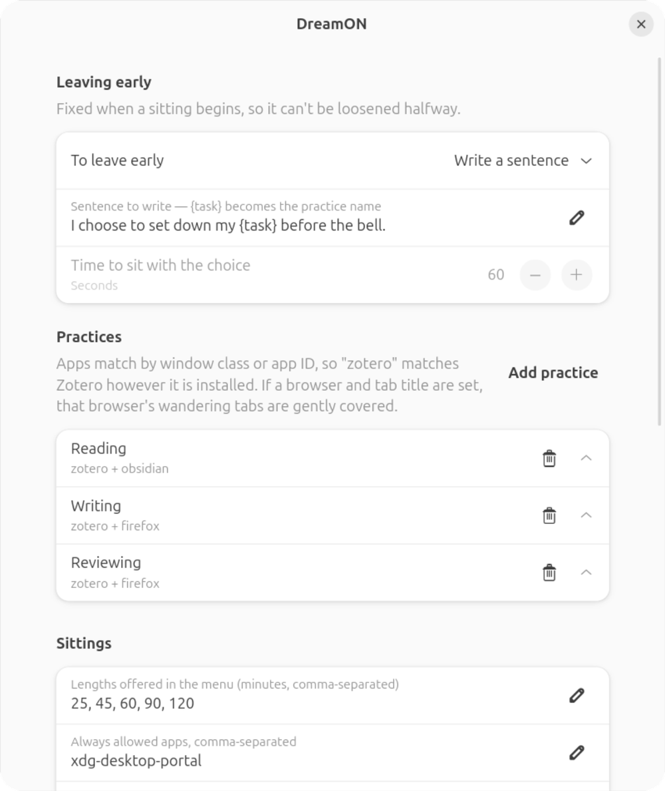

# DreamON

A quiet room for deep work on GNOME: a top-bar extension that keeps only one practice's apps on screen for a sitting, and a companion app that shows what your practice adds up to.



## The extension



Pick a practice and a length from the ensō in the top bar (or from the app). For that sitting, only the practice's apps stay on screen:

| Practice  | Allowed          | Watched tabs                     |
|-----------|------------------|----------------------------------|
| Reading   | Zotero, Obsidian | —                                |
| Writing   | Zotero, Firefox  | Firefox tabs must be Google Docs |
| Reviewing | Zotero, Firefox  | Firefox tabs must be Google Docs |

During a sitting:

- Any other window is minimized as soon as it appears or gets focus, and focus returns to your last allowed window.
- The overview and app grid close as soon as they open.
- Notification banners are quiet.
- In Writing and Reviewing, a tab whose title doesn't contain "Google Docs" is covered after about 1.5 seconds. The tab bar stays uncovered so you can click back, and Ctrl+Tab and Ctrl+W still work.
- The top bar shows the ensō and the minutes left (e.g. `42m`).

Set up your displays first. Moving or swapping allowed windows between displays stays free (Super+Shift+←/→).

The sitting ends with a bell (a notification), on its own timer so nothing else can delay it. It survives screen lock, logout and reboot.

### Leaving early

This is set in Settings and fixed when a sitting begins:

- **Write a sentence** (default): type "I choose to set down my writing before the bell." The sentence is shown as a non-selectable label, so it can't be copy-pasted.
- **Sit with it, then leave**: wait 60 s (adjustable) before the Leave button works.
- **Stay until the bell**: no early exit.

Neither the app nor anything else can end a sitting. "Leave early…" in the app opens the same dialog.

### A day without YouTube

"Make today a No YouTube day" (from the ensō menu or the app) covers any browser tab whose title says YouTube until midnight, during sittings and between them. A declared day can't be taken back. In Settings you can add other sites, choose which browsers are watched, or make every day one.

## The app

Open **DreamON** from the app grid or the ensō menu. The ensō is its measure: a sitting's ensō draws itself as the sitting goes on, and each day's ensō closes when the day's practice reaches 2 hours. The app follows GNOME's light and dark style. It has five pages:

- **Today**: today's ensō, or the sitting's ensō with its countdown; begin a sitting; today's sittings, pages and distractions; and declare a No YouTube day.
- **Practice**: the last 7 days as ensō coloured by practice, an 18-week calendar of ensō, current and longest streaks, and how many sittings you kept to the bell.
- **Reading**: pages read and time with the page, your pace, and the papers you sat with. Titles come from Zotero's local API, and clicking a paper opens it in Zotero.
- **Distractions**: which apps and tabs pulled at you, and your record of No YouTube days, including how often you reached for it.
- **History**: every sitting, day by day.

Everything stays on your machine. The extension writes its log to `~/.local/share/dreamon/`:
- `sittings.jsonl`, one line per sitting
- `days.json`, for No-site days

The app reads that log. Its only other source is Zotero's local API on `127.0.0.1`, which needs Zotero running with Settings → Advanced → "Allow other applications on this computer to communicate with Zotero".

Pages read come from the Ethereal Style plugin's `~/Zotero/reading-progress.json`, which DreamON only reads. A page counts after 30 s.

### The day's line

Above the ensō, the Today page shows one line a day, with its author and source. It goes through every line once, in a shuffled order, before any repeats; click it for another. The lines come from `~/.local/share/dreamon/lines.json`, which you keep yourself and which never goes in the repository:

```json
[
  {"text": "Every beginning is difficult, holds in all sciences.", "author": "Karl Marx", "source": "Capital I, Preface"}
]
```

Without the file, a few built-in lines are used.

### Screenshots

| Practice | Reading |
|---|---|
|  |  |
| **Distractions** | **History** |
|  |  |

## Install

Requires GNOME Shell 50, plus Python 3 with GTK 4 and libadwaita (PyGObject).

```bash
git clone https://github.com/sgakhil/dreamon.git
cd dreamon
./install.sh            # extension and app; or: ./install.sh extension | app
# log out and back in, then:
gnome-extensions enable dreamon@sgakhil.github.io
```

To try the extension without touching your session:

```bash
dbus-run-session bash -c '
  gnome-shell --devkit --wayland &
  sleep 6
  gnome-extensions enable dreamon@sgakhil.github.io
  wait'
```

## Settings



Open Settings from the ensō menu, the gear in the app, or `gnome-extensions prefs dreamon@sgakhil.github.io`. You can configure:

- practices: name, allowed apps, the browser to watch, and the required tab title
- sitting lengths
- apps allowed in every practice
- the top bar display
- the tab bar height left uncovered
- No-site days
- the reading-progress file

Apps match by window class or app ID, so `zotero`, `obsidian` and `firefox` work for native, Flatpak and Snap installs.

<br clear="right">

## Packaging

`./pack.sh` builds `dreamon@sgakhil.github.io.shell-extension.zip` (the extension only), the file to upload to extensions.gnome.org.

## Limits

- It can't stop wandering inside Zotero or Obsidian themselves.
- The tab cover is a window-sized overlay. If another allowed window overlaps a covered browser window on the same display, the overlay covers it too.
- It's a self-imposed lock. Determined escape routes still exist (a TTY, `dconf`), and that's by design.

## Debugging

```bash
journalctl -f -o cat /usr/bin/gnome-shell   # extension errors
dreamon-app                                 # app errors print in the terminal
gdbus call --session --dest org.gnome.Shell --object-path /io/github/sgakhil/DreamON \
  --method io.github.sgakhil.DreamON.GetState   # what the extension reports
```

## License

MIT
